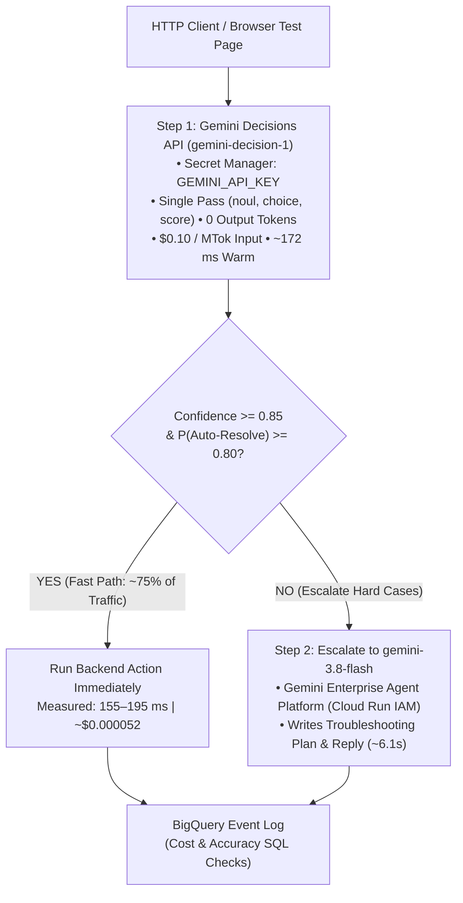

# Gemini Decisions API — Python & Google Cloud Run Examples

[](https://cloud.google.com/run)
[](https://blog.google/innovation-and-ai/technology/developers-tools/gemini-decisions-api/)
[](https://cloud.google.com)
[](LICENSE)

Runnable Python scripts and Google Cloud Run services demonstrating **Google DeepMind's [Gemini Decisions API](https://blog.google/innovation-and-ai/technology/developers-tools/gemini-decisions-api/) (`gemini-decision-1`)**—evaluating `yes/no` (`noul`), multiple-choice (`choice`), rubric (`score`), and multimodal (photo & PDF) decisions in a single pass with **zero output tokens**, alongside automatic escalation to **Gemini 3.8 Flash** and **BigQuery** telemetry.

* For complete step-by-step setup and deployment commands, see **[TUTORIAL.md](TUTORIAL.md)**.

---

## ⚡ Quickstart: Run Locally in 60 Seconds

Requires **Python 3.11+** and a **Gemini API Key** from [Google AI Studio](https://aistudio.google.com/api-keys):

```bash
git clone https://github.com/rominirani/gcp-gemini-decisions-hybrid-gateway.git
cd gcp-gemini-decisions-hybrid-gateway

python3 -m venv .venv
source .venv/bin/activate
pip install -r requirements.txt

export GEMINI_API_KEY="YOUR_GEMINI_API_KEY"

# 1. Ticket routing + calibrated caution on unverified refunds (0 output tokens)
python scripts/quickstart_decisions.py

# 2. 8 policy, PII & prompt-injection checks in one API call
python scripts/parallel_guardrails.py

# 3. Photo (resolution="low" vs "high") & PDF invoice check without OCR
python scripts/multimodal_triage.py
```

---

## 📐 Cloud Run Router Architecture (`02-hybrid-gateway/`)



---

## 📂 Repository Structure

```text
.
├── scripts/
│   ├── quickstart_decisions.py  # Routing + calibrated caution on unverified refunds
│   ├── parallel_guardrails.py   # 8 policy, PII & injection checks in 1 API call
│   ├── multimodal_triage.py     # Photo resolution (4x savings) + PDF check without OCR
│   └── setup_gcp.sh             # Enables GCP APIs, Secret Manager, IAM SA & BigQuery table
├── 01-decisions-classifier/     # Minimal standalone Cloud Run classifier (164–185 ms)
├── 02-hybrid-gateway/           # Cloud Run request router + browser test UI + Gemini 3.8 Flash escalation
├── 03-multimodal-triage/        # Cloud Run multipart image/PDF upload API + SSRF & magic-byte checks
├── 04-pubsub-policy-stream/     # Cloud Pub/Sub push worker running 8 policy checks per message
├── 05-bigquery-finops/          # Partitioned BigQuery schema, seeder & cost/accuracy SQL queries
├── .env.example                 # Sanitized environment template (zero fallbacks)
├── requirements.txt             # Python dependencies (google-genai >= 3.2.0)
└── TUTORIAL.md                  # Step-by-step terminal runbook
```
